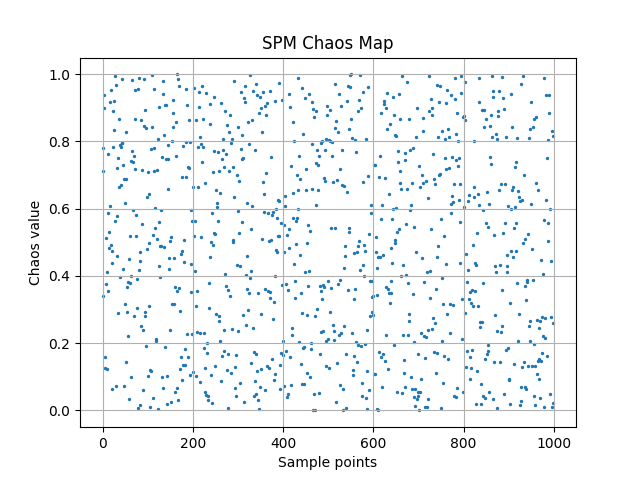
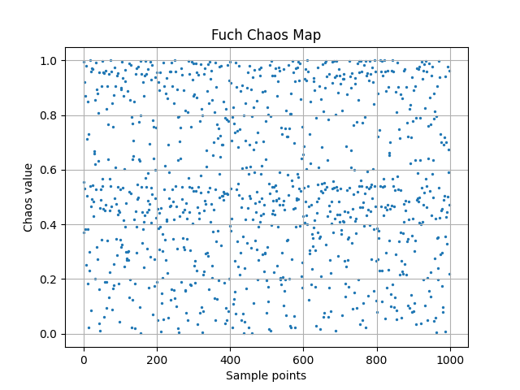
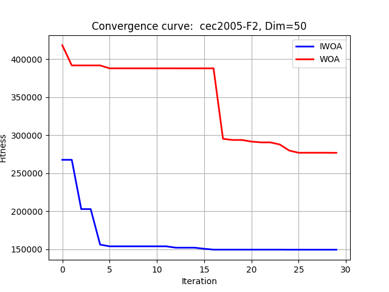
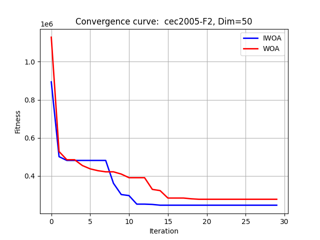
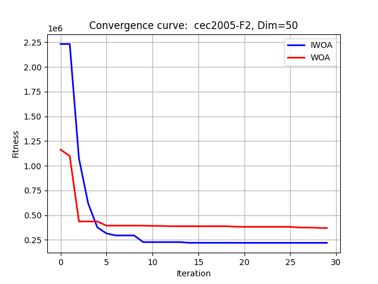
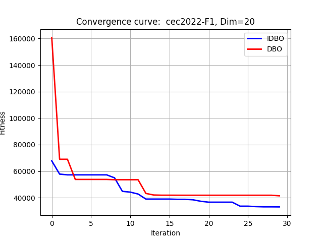
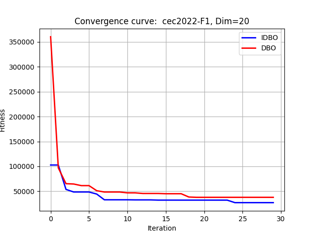
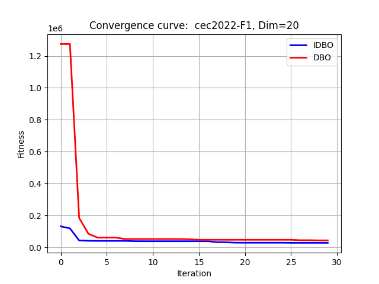
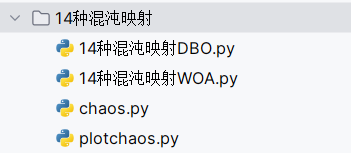

# 14 types of chaos maps, Python code

"This issue employs 14 commonly and uncommonly used chaos mapping algorithms for optimizing intelligent algorithm optimization, with a Chaos class written by the author to facilitate easy invocation. The code can be switched on-the-fly, applicable to all intelligent algorithm optimizations. This article introduces the whale and locust algorithms as examples."

The article involves 14 chaos mapping algorithms for use during the initialization of intelligent algorithm particles, including: Tent mapping, Fuch mapping, Henon mapping, SPM mapping, Logistic mapping, Cubic mapping, Chebyshev mapping, Piecewise mapping, sinusoidal mapping, Sine mapping, ICMIC mapping, Circle mapping, Bernoulli mapping, Singer mapping. Regarding the principles of each method's mapping, this article will not elaborate further.

01  
—  
What is the purpose of choosing chaos mapping?

Experiments have proven that using chaos mapping to generate random numbers significantly improves the fitness function values. Replacing the conventional uniform distribution random number generator with chaos mapping can yield better results, especially when there are many local solutions in the search space, making it easier to find the global optimal solution. In short, chaos mapping enhances the randomness and diversity of particles.

02  
—  
Visualization of chaos mapping

Using Python code, we can visualize the chaos mapping. Taking the SPM mapping and Fuch mapping as examples, we can see the result images. Of course, this can also be seen from the naked eye without significant differences. The other 12 types of chaos mappings produce similar results, so they are not shown one by one.

The visualization code is as follows:
from chaos import Chaos  #A self-written one.class\nimport numpy as np\nimport math\nfrom matplotlib import pyplot as plt\n\ndim = 1000\nlb = np.zeros([dim,1])\nub = np.ones([dim,1])\nchaos_ = Chaos(1, dim, lb, ub)  # Generate aChaosClass\n\n'''\n        Optional functions are available.: tent_initial, fuch_initial, sine_initial, singer_initial, henon_initial,cubic_initial, \n                icmic_initial, bernoulli_initial, chebyshev_initial, circle_initial, logistic_initial, \n                piecewise_initial, sinusoidal_initial SPM_initial\n        Corresponds to the corresponding chaos map! \n    '''\nposs_sols = Chaos.fuch_initial(chaos_)  # Generatechaos_The specific chaotic mapping function can be introduced.! \n\n''' \n    Draw chaos map\n'''\nx = np.array(range(0,dim)).reshape(1,-1)\nplt.scatter(x,poss_sols,s=2)\nplt.title('Fuch Chaos Map')\nplt.xlabel('Sample points')\nplt.ylabel('Chaos value')\nplt.grid()\nplt.show()\n  
It can be seen that in the code, a Chaos class written by the author is called. With this class, everyone can call different chaos mapping methods just like calling Python libraries.
03  
—  
14 types of chaos mapping optimized whale algorithm
Taking SPM, Fuch, Tent chaos mapping as examples, tests were conducted on CEC2005, with F2 function dim=50. The results of using different chaos mapping optimized whale algorithms are as follows:
WOA algorithm for SPM chaos mapping:
The modified code is as follows.
poss_sols = Chaos.SPM_initial(chaos_)  # Generatechaos_The specific chaotic mapping function can be introduced.! \n  
WOA algorithm for Fuch's chaotic map:
Simply modify the code as shown below.
poss_sols = Chaos.fuch_initial(chaos_)  # Generatechaos_The specific chaos mapping function can be introduced.! \n  
Tent mapping
poss_sols = Chaos.tent_initial(chaos_)  # Generatechaos_The specific chaotic mapping function can be introduced.! \n  
14 Chaos Mapping Optimized Dung Beetle Algorithms
Taking the Icmic, Fuch, and Sinusoida chaos mappings as examples, the optimization of the Dung Beetle algorithm was tested on the F1 function with a dimension of 20 in the CEC2022 competition. The results of different chaos mapping optimized Dung Beetle algorithms are as follows:
Icmic chaos mapping's DBO algorithm:
The modified code is provided below.
X= Chaos.icmic_initial(chaos_)  # Generatechaos_The specific chaotic mapping function can be introduced.! \n  
Fuch chaotic map's DBO algorithm:
Modify the code as follows.
X= Chaos.fuch_initial(chaos_)  # Generatechaos_The specific chaotic mapping function can be introduced.! \n  
DBO algorithm for sinusoidal mapping:
Modify the code accordingly.
X= Chaos.sinusoidal_initial(chaos_)  # Generatechaos_The specific chaotic mapping function can be introduced.! \n  
04  
-  
Results Analysis  
It can be observed that the function after adding chaos mapping tends to find smaller values more quickly in the early stages of algorithm optimization. This indicates that the chaos mapping has played a role!  
It should be noted here that, theoretically speaking, chaos mapping optimizes intelligent algorithms by making the initial particles more random and diverse. This is indeed capable of accelerating the convergence speed of the algorithm. However, once the loop begins, the remaining work does not involve chaos optimization anymore.  
In other words, if I directly generate a set of particles using the rand function, there is a certain probability that they are better than those generated by chaos optimization. Although this probability is small, it is indeed present. Therefore, if occasionally chaos optimization fails to perform well, do not be disheartened. After all, chaos optimization is just one means of optimizing intelligent algorithms. We can combine other methods for optimization.  
05  
-  
Code Directory  
Among them, chaos.py is a class written by the author for the 14 types of chaos mappings. The main function "14 Types of Chaos Mapping DBO.py" is convenient for calling and can also be used for other algorithm improvements. The plotchaos.py file is used for plotting chaos maps. The name chaos is English, which seems quite reasonable. It's humorous how such naming makes sense. This allows for easy switching and can easily be extended to other code.

## Images

<!-- PAYMENT_BLOCK -->

## Get this dataset

- Payment link (Stripe): [Buy now](https://buy.stripe.com/3cs8yP7sY87d0vu9AB)
- Payment QR code: 

<!-- /PAYMENT_BLOCK -->
